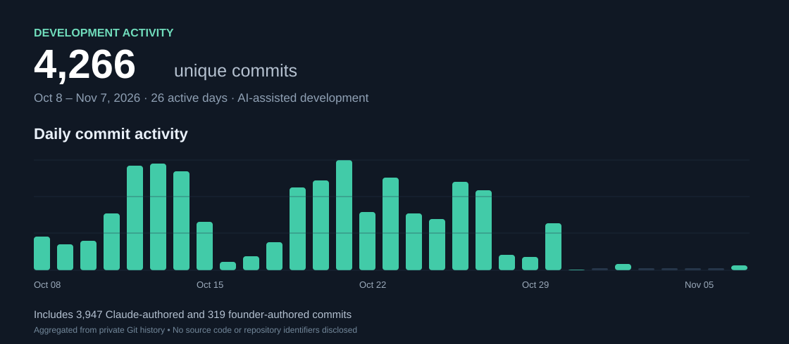

# Building at AI speed.

**Founder-led, AI-assisted software development. Private code. Public progress.**

### Development snapshot

- **4,266 unique Git commits** across private development branches, October 8–November 7, 2026
- **26 active development days** in the recorded period
- **3,947 AI-agent-authored commits** (Claude) and **319 founder-authored commits**
- **3 application platforms:** iOS, macOS, and web
- **Around 50 iOS app iterations** (founder-reported; not derived from Git commits)

I build and ship products through a founder-led, AI-assisted development workflow. The underlying repositories and source code remain private.

*The chart is calculated from unique commits across private remote-tracking branches, grouped by date in Europe/Amsterdam time. Commit totals are not GitHub profile contributions, lines of code, features, or releases. Snapshot exported November 2026.*
